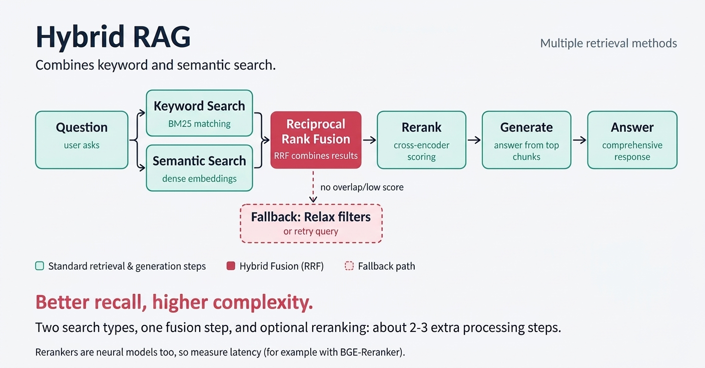

# Hybrid RAG (Retrieval-Augmented Generation)

This repository contains a Python notebook implementation of **Hybrid RAG**, which combines keyword and semantic search to improve retrieval recall and generation accuracy.

## 📌 Overview

Traditional RAG systems typically rely on a single retrieval method (dense semantic search). While excellent at understanding user intent, semantic search can miss exact keyword matches, SKU numbers, or specific technical terms where traditional keyword search (BM25) excels. 

**Hybrid RAG** combines the best of both worlds:
1. **Keyword Search (BM25):** Precise, keyword-exact matching.
2. **Semantic Search (Dense Embeddings):** Concept-based, contextual understanding.

These search results are merged using **Reciprocal Rank Fusion (RRF)**, followed by a **Reranking** phase to ensure the language model only receives the most relevant content.

---

## 🛠️ How It Works

1. **Question:** The user enters a query.
2. **Retrieve (Dual-Path):** 
   - BM25 matching handles keyword search.
   - Dense embeddings capture semantic similarities.
3. **Hybrid Fusion (RRF):** Reciprocal Rank Fusion algorithmically merges and ranks the results.
4. **Fallback Path:** If results lack overlap or are too low-scoring, filters are relaxed or the query can be retried.
5. **Rerank:** A cross-encoder grades and prioritizes top results.
6. **Generate & Answer:** The LLM receives highly relevant context and generates a grounded response.
